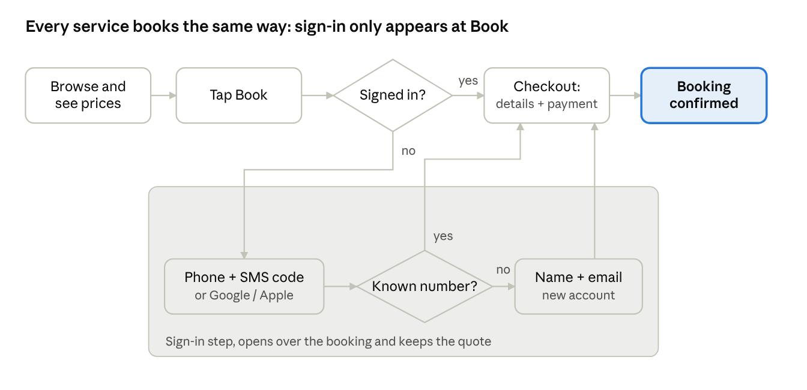
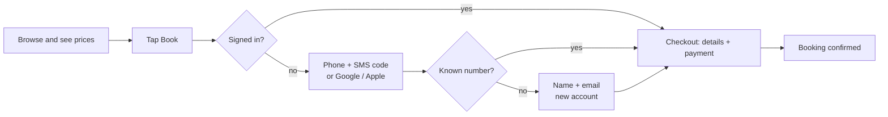

# Ridean — One Account & Checkout: Developer Spec

Nov 11, 2026 · Shakib Haider · Live version: the "Ridean — One Account & Checkout: Developer Spec" doc

## Overview

Ridean gets one account and one sign-in that work for every service (Ride Now, Airport Transfer, Hourly chauffeur, Luxury chauffeur, Rent a car) on the website, PWA and iOS/Android app. Anyone can browse and see prices without an account. The account is created the first time someone taps Book, with a verified mobile number, in about 20 seconds.

**Goals**

- Nobody is asked to sign up before they have seen prices.
- One flow to learn: every service books the same way.
- One identity: a trip, card or saved address added on one platform shows up on all of them.
- Every booking has a verified phone and email, so drivers and suppliers can always reach the passenger.

**In scope**

- Phone sign-in with a one-time SMS code, email code fallback, Google and Apple sign-in.
- Inline sign-in inside the booking flow (no leaving the booking).
- Saved payment methods shared across services and platforms (Stripe).
- Service-specific details collected once and saved: rental driver details, business profile.
- Risk-based identity check for flagged accounts only.
- Admin tools to see, verify, flag and support accounts.

**Out of scope for this release**

- Self-drive car sharing (it would need mandatory ID and selfie checks).
- Driver/supplier accounts (handled by supplier APIs).

**Principles**

1. Ask for information only at the moment a booking needs it.
2. Collect only what suppliers need: name, phone, email, payment, and driver details for rentals.
3. No password required; a password or passkey is an optional extra in Settings.
4. The same API and rules power all four surfaces; no platform-specific account logic.

## User flows

Sign-in appears only when someone taps Book, opens over the booking, and returns them to the same quote.

A returning customer who is already signed in goes straight from Book to checkout; everyone else passes through the sign-in step once.

**Flow details**

1. **Browse:** every service's search and live prices work signed out.
2. **Tap Book (any service):** the client checks for a valid session. Signed in → checkout. Signed out → the sign-in step opens as a sheet (app/PWA) or modal (website) over the booking.
3. **Phone + SMS code:** the person enters a mobile number and the 6-digit code. Google or Apple is an alternative; those users still verify a phone once.
4. **Known number:** the account signs in and the booking continues.
5. **New number:** one screen for first name, last name, email and the terms box creates the account; the booking continues.
6. **Checkout:** service-specific details (rental driver, flight number) and payment, saved for next time.
7. **Confirmed:** confirmation screen, email receipt, and the trip appears in Trips on every platform.

**Returning on another platform:** signing in on a new device uses the same phone code; trips, saved cards, addresses and drivers are already there because they belong to the account, not the device.

**Lost phone number:** "Use email instead" signs in with an email code; the user then changes the phone in Settings › Profile (new number verified by SMS).

## Account rules

Every rule below is the same on website, PWA and app. "Required" means the booking cannot be confirmed without it.

| Item | Rule | When it is asked | Notes |
| --- | --- | --- | --- |
| Browse and see prices | No account needed | Never blocked | All search and quote endpoints are public (rate-limited). |
| Mobile number | Required, verified by 6-digit SMS code | First tap on Book | E.164 format. Unique per account. Country comes from the dialling code. |
| First and last name | Required | Right after the phone code, new accounts only | Passed to suppliers as the passenger name. |
| Email | Required; verified by link, does not block booking | Same screen as name | Receipts and invoices go here. Unique per account. |
| Language and currency | Auto from device, editable | Never asked | Stored on the profile; used for prices and emails. |
| Password | Optional | Settings › Security | Minimum 8 characters, hashed with argon2id. Passkey optional later. |
| Google / Apple sign-in | Optional shortcut | Sign-in screen | Phone still verified once before the first booking. |
| Payment method | Required to book | Checkout | Stripe card, Apple Pay, Google Pay; saved to the account. Ride Now needs a saved card before requesting a car. |
| Profile photo | Optional | Settings › Profile | Never required. |
| Rental driver details | Required for Rent a car only | Rent a car checkout, once | Main driver name, date of birth, licence country. No licence upload; the rental company checks it at the counter. Saved for reuse. |
| Flight number | Optional | Airport Transfer checkout | Airport pickups only; used for live flight tracking. |
| Business profile | Only for business accounts | When joining or creating a business | Work email verified by link; admin invites employees. |
| Identity check (ID + selfie) | Only when the risk engine flags the account | Before the next booking | Stripe Identity. Never for normal customers. |

**Account states**

| State | Meaning | Can book? |
| --- | --- | --- |
| Active | Phone verified | Yes |
| Email unverified | Phone verified, email link not clicked | Yes; banner shows "Confirm your email" |
| Needs ID check | Flagged by risk rules | No; shown the ID check screen |
| Suspended | Set by admin | No; shown a support contact |
| Deleted | User deleted the account | No; personal data removed, invoices kept for tax records |

## Screens to change

The website (`apps/website`), PWA (`apps/pwa`) and Flutter app (`apps/mobile`) get the same screens; admin (`apps/admin`) gets support tools. Use the Emerald & Gold designs for look and spacing.

| Screen | Surfaces | Change |
| --- | --- | --- |
| Continue with phone (replaces Sign in + Create account) | Web, PWA, App | Phone field with country picker → "Send code". Google and Apple buttons below. "Use email instead" link sends a code by email. |
| Enter code | Web, PWA, App | 6 boxes, auto-advance, paste support, SMS autofill (`autocomplete="one-time-code"`, Android SMS Retriever, iOS code suggestion). Resend after 30 s. Wrong code message. |
| About you (new accounts only) | Web, PWA, App | First name, last name, email, terms checkbox. Prefill from Google/Apple when available. |
| Booking sheet (all services) | Web, PWA, App | Book / Continue button checks the session. Not signed in → opens the phone step as a sheet/modal over the booking, then returns to the same step with the quote kept. |
| Checkout › Payment | Web, PWA, App | Saved methods list + add card (Stripe Payment Element / Flutter Stripe SDK). Apple Pay, Google Pay. |
| Rent a car › Driver details | Web, PWA, App | Main driver name, date of birth, licence country; "Save for next time" on by default; young-driver fee shown when under 25. |
| Ride Now › Request | Web, PWA, App | Disabled until a card is saved; shows "Add a payment method" inline. |
| Email banner | Web, PWA, App | "Confirm your email" banner with Resend while unverified. |
| Settings › Security | Web, PWA, App | Add or change password, signed-in devices with Sign out, delete account. |
| Settings › Profile | Web, PWA, App | Change phone (re-verify new number), change email (re-verify), optional photo. |
| ID check | Web, PWA, App | Only for flagged accounts: Stripe Identity hosted flow, then "We'll review this". |
| Admin › Users | Admin | Columns: phone verified, email verified, sign-in method, risk flag. Drawer: resend email link, clear flag, require ID check, suspend, view devices, sign out all devices. |
| Admin › Settings | Admin | OTP settings: code length, expiry, resend wait, daily limit per number, blocked country codes. |

**Copy (use exactly)**

- Phone screen title: "Continue with your phone"
- Code screen: "Enter the 6-digit code we sent to {phone}"
- New account: "Almost done — tell us who's riding"
- Ride Now without card: "Add a payment method to request a car"

## Backend

Build this in the existing NestJS API (`apps/api`) with Drizzle and PostgreSQL. One `auth` module serves all four surfaces. Sessions use a short-lived JWT access token plus a rotating refresh token.

### Data model (Drizzle)

| Table | Key columns | Notes |
| --- | --- | --- |
| `users` | `id` uuid, `phone_e164` unique, `phone_verified_at`, `email` unique (citext), `email_verified_at`, `first_name`, `last_name`, `country`, `language`, `currency`, `password_hash` nullable, `photo_url` nullable, `status` (active, needs_id_check, suspended, deleted), `risk_flag` bool, `stripe_customer_id`, `created_at` | Existing users table: add the missing columns in a migration; existing email/password users keep working. |
| `auth_identities` | `id`, `user_id`, `provider` (phone, email, google, apple, password), `provider_subject`, `created_at` | Unique on (`provider`, `provider_subject`). Links Google/Apple to the same user by verified email or phone. |
| `otp_codes` | `id`, `channel` (sms, email), `destination`, `code_hash`, `purpose` (sign_in, change_phone, change_email), `attempts`, `expires_at`, `consumed_at`, `ip`, `created_at` | Store only a hash (SHA-256 + server pepper). |
| `sessions` | `id`, `user_id`, `refresh_token_hash`, `device_name`, `platform` (web, pwa, ios, android), `ip`, `last_seen_at`, `revoked_at` | One row per signed-in device; powers "Signed-in devices". |
| `email_verifications` | `id`, `user_id`, `email`, `token_hash`, `expires_at`, `used_at` | Link valid 24 h. |
| `driver_profiles` | `id`, `user_id`, `full_name`, `date_of_birth`, `licence_country`, `is_default` | For Rent a car; a user may save more than one driver. |
| `payment_methods` | `id`, `user_id`, `stripe_payment_method_id`, `brand`, `last4`, `exp_month`, `exp_year`, `is_default` | Card data stays at Stripe; only these display fields are stored. |
| `risk_events` | `id`, `user_id`, `type` (failed_payment, chargeback, otp_abuse, admin), `detail` jsonb, `created_at` | Feeds the risk rules in Security. |

### API endpoints

| Method + path | Auth | Purpose |
| --- | --- | --- |
| `POST /auth/otp/start` | Public | Body `{channel, destination}` → sends a code. Always returns 200 with `resendAfter`, even for unknown numbers. |
| `POST /auth/otp/verify` | Public | Body `{channel, destination, code, device}` → `{accessToken, refreshToken, user, isNewUser}`. Creates the user on first verify. |
| `POST /auth/oauth/google`, `POST /auth/oauth/apple` | Public | Body `{idToken}` → same response. Sets `needsPhone: true` until a phone is verified. |
| `POST /auth/refresh` | Refresh token | Rotates the refresh token; reuse of an old token revokes the session. |
| `POST /auth/logout` | User | Revokes the current session. |
| `GET /me`, `PATCH /me` | User | Read/update name, language, currency, photo. |
| `POST /me/phone`, `POST /me/email` | User | Change phone/email; triggers a new verification. |
| `POST /me/email/resend`, `GET /auth/email/verify?token=` | User / Public | Email link flow. |
| `POST /me/password` | User | Set or change the optional password (needs a fresh OTP if one exists). |
| `GET /me/sessions`, `DELETE /me/sessions/:id` | User | Signed-in devices. |
| `GET/POST/DELETE /me/drivers` | User | Saved rental drivers. |
| `POST /me/payment-methods/setup-intent`, `GET /me/payment-methods`, `DELETE /me/payment-methods/:id`, `POST /me/payment-methods/:id/default` | User | Stripe SetupIntent flow. |
| `POST /bookings` | User | Rejects with `409 PHONE_NOT_VERIFIED`, `409 PAYMENT_METHOD_REQUIRED` (Ride Now), `409 DRIVER_DETAILS_REQUIRED` (Rent), `403 ID_CHECK_REQUIRED`, `403 ACCOUNT_SUSPENDED`. |
| `POST /me/identity-check` | User | Creates a Stripe Identity session for flagged users. |
| `DELETE /me` | User | Deletes the account (fresh OTP required). |
| `GET /admin/users/:id`, `POST /admin/users/:id/{flag,unflag,require-id,suspend,signout-all}` | Admin | Support tools. |

### OTP service

- Put sending behind an `OtpSender` interface so the planned shared OTP service (also for Send Koro) can replace the first provider without app changes. Start with Twilio Verify or a similar SMS provider; email codes go through the existing mail service.
- Codes: 6 digits, valid 5 minutes, 5 wrong attempts then the code is burned, resend after 30 s, at most 5 codes per number per hour and 10 per day.
- Test mode: in non-production, number `+15005550006` accepts code `000000`; never enabled in production.

### Sessions and tokens

- Access token: JWT, 15 minutes, carries `sub`, `status`, `sid`.
- Refresh token: random 256-bit, 60 days, stored hashed; web and PWA keep it in an `HttpOnly; Secure; SameSite=Lax` cookie, the app in the iOS Keychain / Android Keystore (`flutter_secure_storage`).
- The same user signed in on several devices = several `sessions` rows; data is shared because it all hangs off `user_id`.

### Stripe

- Create the Stripe Customer when the account is created; save `stripe_customer_id`.
- Save cards with SetupIntents (3-D Secure when the bank asks); charge bookings with PaymentIntents on the saved method.
- Turn on Stripe Radar. Webhooks: `payment_intent.payment_failed` and `charge.dispute.created` write `risk_events`; `identity.verification_session.verified` clears `needs_id_check`.

## Security, fraud and privacy

**Abuse limits**

- Rate-limit `POST /auth/otp/start` per IP (10/hour), per number (limits in OTP service) and globally; add a CAPTCHA (Cloudflare Turnstile) after 3 starts from one IP in 10 minutes.
- Block premium-rate and known SMS-pumping prefixes; admin can block whole country codes.
- Never reveal whether a phone or email has an account (same response and timing either way).
- Compare codes in constant time; lock the code after 5 wrong tries.

**Risk rules (set `risk_flag` and `needs_id_check`)**

- 3 failed payments in 24 hours, or any chargeback.
- 5 or more cancelled Ride Now requests in 24 hours.
- Admin flags the account manually.
- Clearing: a verified Stripe Identity check, or an admin unflags.

**Sensitive actions need a fresh code** (OTP within the last 10 minutes): change phone, change email, set password, delete account, add a business account.

**Privacy**

- Store only what suppliers need. No licence images; no card numbers (Stripe holds them).
- Pass to a supplier only that booking's passenger name, phone, email and, for rentals, driver details.
- Data export (`GET /me/export`, JSON) and account deletion meet GDPR/CCPA. On deletion, anonymise personal fields and keep invoices for the legal retention period.
- Log sign-ins and sensitive actions to an audit table; never log codes or tokens.

## Acceptance criteria

The feature is done when every box below passes on website, PWA, iOS and Android, with automated tests for the API items.

**Browsing and sign-in**

- [ ] A signed-out visitor can search every service and see live prices.
- [ ] Tapping Book while signed out opens the phone step over the booking; after sign-in the same quote and step are still there.
- [ ] A new number gets a code, then the About you screen; after it the booking continues.
- [ ] A known number goes straight back to the booking after the code (no About you screen).
- [ ] Google and Apple sign-in work; the user is asked to verify a phone once before the first booking.
- [ ] "Use email instead" signs in an existing account with an email code.
- [ ] Wrong code 5 times burns the code; resend is blocked for 30 s; the 6th code in an hour is refused with a clear message.
- [ ] Unknown and known numbers get identical responses from `/auth/otp/start`.

**Booking rules**

- [ ] Ride Now cannot be requested without a saved card; adding one inline unlocks the button.
- [ ] Rent a car asks for driver details once; the next rental pre-fills them.
- [ ] `POST /bookings` returns each 409/403 code from the Backend table in the right situation.
- [ ] A user with an unverified email can book and sees the Confirm your email banner.

**One account everywhere**

- [ ] A booking made on the website appears in the app and PWA within 5 seconds of opening Trips.
- [ ] A card added in the app is offered at website checkout.
- [ ] Signing out one device from Settings › Security ends that session only.
- [ ] Refresh-token reuse revokes the session.

**Risk and admin**

- [ ] A chargeback webhook flags the account; the next booking attempt shows the ID check.
- [ ] A verified Stripe Identity check clears the flag.
- [ ] Admin can resend the email link, flag, unflag, require ID, suspend and sign out all devices; each action is audit-logged.

**Privacy**

- [ ] Delete account removes personal data, keeps invoices, and signs out all devices.
- [ ] Data export returns profile, trips, payments (last 4 only) and saved addresses.

## Delivery plan

Build the API first, then the three customer surfaces in parallel, then admin and hardening. Each phase ships behind a feature flag (`unified_auth`) and merges to `main` through a pull request with CI green.

1. **API foundation:** migrations for the new tables and columns, `auth` module (OTP start/verify, refresh, logout), `OtpSender` with one SMS provider, unit and e2e tests.
2. **Profile and payments API:** `/me` endpoints, email verification, Stripe customer + SetupIntent, saved drivers, booking guards (409/403 codes).
3. **Website and PWA:** Continue with phone, Enter code, About you, inline sign-in sheet in every booking flow, payment step, Rent driver details, Settings › Security and Profile.
4. **Flutter app:** the same screens, SMS autofill, secure token storage, Apple and Google sign-in.
5. **Admin:** user columns, support drawer actions, OTP settings, audit log view.
6. **Risk and privacy:** risk rules, Stripe Radar and Identity webhooks, data export, account deletion.
7. **Migration and launch:** existing email/password users keep signing in and are asked to verify a phone at their next booking; turn the flag on for staff, then 10%, then everyone.

**Open questions for Shakib**

- [ ] Which SMS provider for launch: Twilio Verify, or wait for the shared OTP service?
- [ ] Which countries at launch (affects SMS cost and blocked prefixes)?
- [ ] Apple and Google developer accounts and Stripe Identity: who sets them up, and when?
- [ ] Minimum rental driver age per supplier (usually 21 or 25): take it from each supplier's API, or fix one rule?
- [ ] Keep "Sign in with email and password" visible on the sign-in screen for existing users, or only in Settings?
